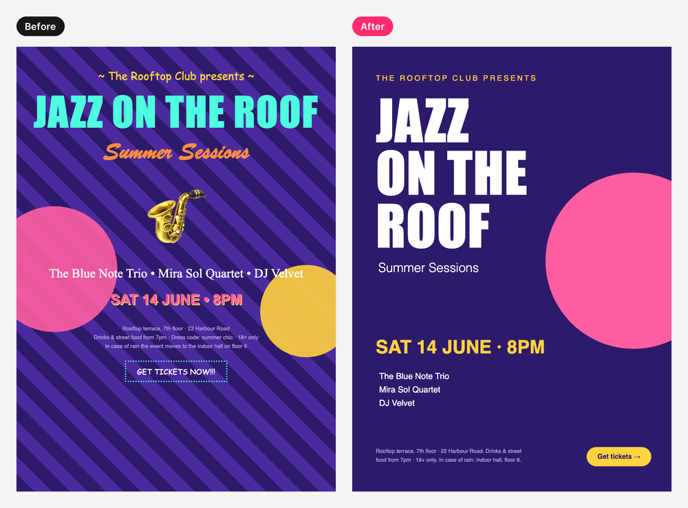

<p align="center"></p>

# pixel-whisperer

**Two Claude skills for designers: turn "make it pop" into a revision plan, and get a desk crit that remembers your progress.**

[English](README.md) · [Русский](README.ru.md)

| | |
|---|---|
| **feedback-decoder** | Client says "make it more modern but cozy, and the logo bigger". You get: what they probably mean (ranked, with confidence), concrete changes with real values from *your* design, what to keep, contradictions, out-of-scope flags, ≤3 closed questions, and a reply in the client's language. A revision ledger counts rounds. |
| **desk-crit** | A studio-style crit for your own work: what works, the 1–3 issues that matter most and the principle behind each, numbered markers on the image, one time-boxed exercise, and a journal that tracks recurring mistakes across sessions ("3rd time: alignment, let's fix this for good"). |

They help you think faster. They don't replace your judgement, your client conversations, your teachers or user research.

## Before / after

Same client message ("bigger red button, more white space but show more restaurants"), same design, same model:

| Without skill | With feedback-decoder |
|---|---|
| Redesigns the screen on its own, misses that the two requests conflict, no reply to the client | TL;DR, ranked readings with confidence, from → to values taken from the design, the conflict resolved, keep-as-is list, ≤3 questions, friendly and firm replies |

<p align="center"></p>

Full side-by-side outputs: [benchmark/RESULTS.md](benchmark/RESULTS.md).

## Install (30 seconds)

**Claude Code**: one install gives you both skills:

```
/plugin marketplace add nazarov-design/pixel-whisperer
/plugin install pixel-whisperer@pixel-whisperer
```

**claude.ai** (Pro, Max, Team or Enterprise with code execution on):
1. Download `feedback-decoder.zip` and/or `desk-crit.zip` from [Releases](https://github.com/nazarov-design/pixel-whisperer/releases/latest).
2. Settings → Features → Skills → upload each zip.

**Manual**: copy `skills/feedback-decoder` or `skills/desk-crit` into `~/.claude/skills/`.

The overlay script needs Python 3 with Pillow (`pip install Pillow`). Without it, the skills still work and describe locations in words.

## Use

Just talk to Claude; the skills trigger on their own. In Claude Code you can also call them directly: `/pixel-whisperer:feedback-decoder`, `/pixel-whisperer:desk-crit`.

```
Client feedback on the landing page (design.png). Round 2 of 3. Project: fintech-landing.
"Feels boring, doesn't pop. More air, but the headline should be bigger. Love the cards."
```

```
Here's my first poster for a course (poster.png). I'm a beginner. What should I improve?
```

Figma: with the Figma MCP connected, paste a frame link instead of a screenshot. The skills read real values (sizes, spacing, colors) from the file.

Say **"quick"** for a short answer (TL;DR, table, one reply) when you're in a hurry.

## Where your data goes

- The ledger (`./.feedback-decoder/<project>.md`) and the journal (`./.desk-crit/student.md`) live **in your own project folder** and are added to that folder's `.gitignore` if it's a git repo.
- The skills never write client names, contact details or money amounts into these files.
- On claude.ai there is no persistent folder, so Claude gives you the ledger/journal as a file to re-attach next time.

## Examples

Three worked examples per skill, with inputs, full outputs and overlays. All designs are made-up HTML pages rendered to PNG.

| feedback-decoder | desk-crit |
|---|---|
| [SaaS landing, round 2/3, EN](examples/feedback-decoder/01-saas-landing) | [Beginner poster, v1 → v2 with progress](examples/desk-crit/01-beginner-poster) |
| [Coffee shop, scope creep, EN](examples/feedback-decoder/02-coffee-shop) | [Intermediate dashboard, 3rd-time escalation, RU](examples/desk-crit/02-intermediate-dashboard) |
| [Savings app, last round, client in RU](examples/feedback-decoder/03-fintech-app-ru) | [Advanced onboarding, "be tough"](examples/desk-crit/03-advanced-mobile) |

## Benchmark

20 vague-feedback cases and 10 student works, a with/without runner that isolates Claude from your other skills, and a rubric for human designers. See [benchmark/](benchmark/).

Blind AI-judge scores, 5 cases each (1–5): **feedback-decoder 4.67 vs 2.97** without the skill · **desk-crit 4.53 vs 2.90**. Details and caveats: [RESULTS.md](benchmark/RESULTS.md).

## Limitations

- **It reads pixels, not intent.** From a screenshot, sizes and colors are estimates (marked `~`). Connect Figma for exact values.
- **Interpretations are guesses with confidence levels**, not mind reading. When confidence is low, it asks instead of guessing.
- **Marker placement** is usually right but can be off on dense layouts; Claude checks and redraws, but glance at it before sending to anyone.
- **Not a lawyer or a project manager.** The scope guard flags new requests; your contract decides what's in scope.
- **Desk crit is a practice partner**, not a teacher. It can't see your process, your sketches or your users.
- Benchmarks were scored by an AI judge on a small sample; treat them as a sanity check, not proof. Human scoring is welcome.

## Repo layout

```
.claude-plugin/        marketplace.json + plugin.json
skills/feedback-decoder/  SKILL.md · references/ (phrasebook, replies, ledger) · scripts/annotate.py
skills/desk-crit/         SKILL.md · references/ (principles, exercises, crit-examples, journal) · scripts/annotate.py
shared/annotate.py     source of truth for the image script (tools/sync.sh copies it)
examples/  benchmark/  tools/
```

Build the claude.ai zips with `tools/build_dist.sh`. Re-run the examples with `tools/run_examples.sh`.

## Author

Built by **Vladislav Nazarov**, product designer. [github.com/nazarov-design](https://github.com/nazarov-design)

Portfolio: [vladislav-nazarov.vercel.app](https://vladislav-nazarov.vercel.app)

Feedback, phrase suggestions for the phrasebook and new exercises are welcome as issues or PRs.

MIT License.
