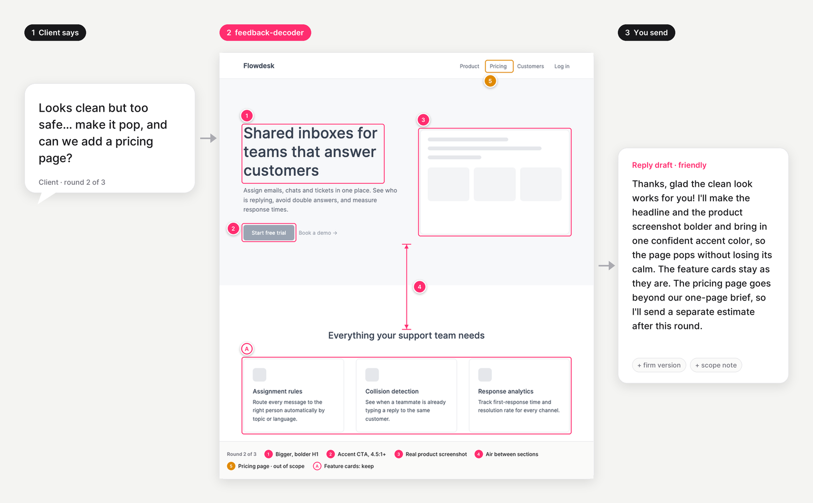

<p align="center"></p>

# pixel-whisperer

**Два скилла Claude для дизайнеров: превратить «сделайте, чтобы цепляло» в план правок и получить разбор работы, который помнит ваш прогресс.**

[English](README.md) · Русский

- **feedback-decoder** берёт размытый фидбек клиента на любом языке и дизайн (скриншот или фрейм Figma). Он выдаёт:
  - варианты прочтения каждой фразы с уверенностью и конкретные правки по реальным значениям из макета;
  - список «что не трогать», противоречия и запросы вне брифа;
  - до 3 закрытых вопросов клиенту и черновик ответа на языке клиента, в двух тонах: дружелюбном и твёрдом;
  - леджер, который считает раунды правок.
- **desk-crit** — разбор как в дизайн-школе:
  - что работает и 1–3 главные проблемы с принципом за каждой;
  - номера прямо на картинке и одно упражнение на 20–60 минут;
  - журнал прогресса: если ошибка повторяется в третий раз, он скажет об этом прямо.

Это помощники, а не замена дизайнеру, разговору с клиентом, преподавателю или исследованиям.

## Установка

**Claude Code**:
```
/plugin marketplace add nazarov-design/pixel-whisperer
/plugin install pixel-whisperer@pixel-whisperer
```

**claude.ai** (платный тариф, включено выполнение кода): скачайте zip-архивы из [Releases](https://github.com/nazarov-design/pixel-whisperer/releases/latest) и загрузите их в Settings → Features → Skills.

Для картинок с маркерами нужен Python 3 и Pillow (`pip install Pillow`). Без них скиллы тоже работают, просто описывают места словами.

## Данные

Леджер (`./.feedback-decoder/`) и журнал (`./.desk-crit/`) лежат только в папке вашего проекта и добавляются в `.gitignore`. Имена клиентов, контакты и суммы денег в эти файлы не пишутся.

## Ограничения

- По скриншоту размеры оцениваются примерно. Точные значения дают только при подключённой Figma.
- Трактовки фидбека — это гипотезы с уверенностью, а не чтение мыслей.
- Бенчмарк небольшой и оценён ИИ-судьёй. Это проверка здравого смысла, а не доказательство.

Подробности, примеры и бенчмарк — в [README на английском](README.md).

**Автор:** Владислав Назаров, продуктовый дизайнер. [github.com/nazarov-design](https://github.com/nazarov-design). Лицензия MIT.
